# Terraform AWS VPC + EC2

Provisions a VPC with public and private subnets, a web server, a container registry, and a private PostgreSQL database on AWS using reusable Terraform modules, with remote state stored in S3 and a GitHub Actions pipeline that checks every pull request.

## Architecture

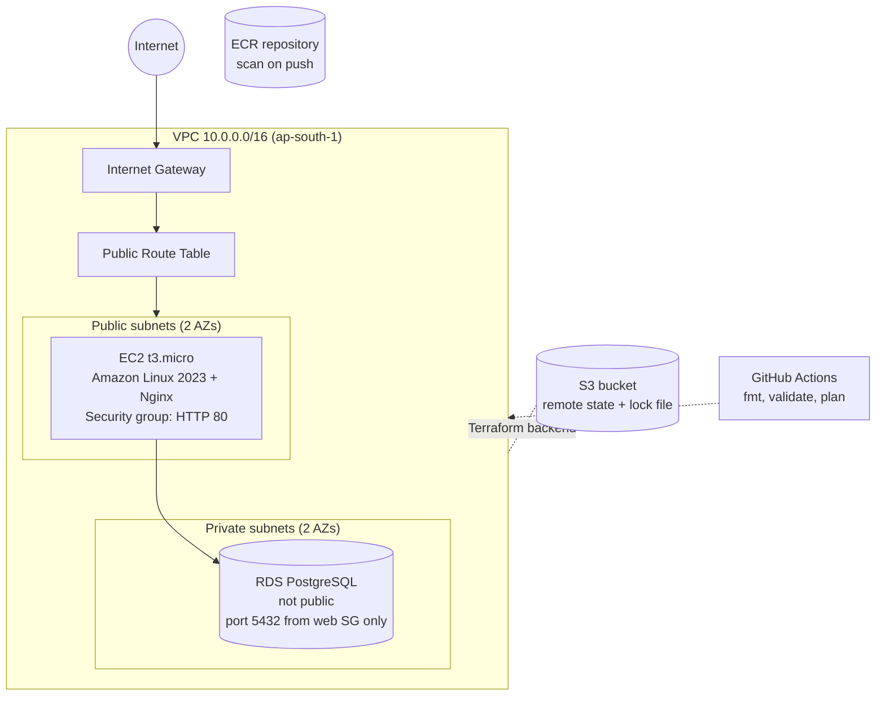

## What it creates

- A VPC with DNS hostnames enabled
- 2 public and 2 private subnets across two availability zones
- An internet gateway, a public route table, and route table associations
- A security group allowing inbound HTTP (port 80) only
- An EC2 instance (latest Amazon Linux 2023 AMI via an SSM parameter) running Nginx through user data
- An ECR repository with image scanning on push and a lifecycle policy that keeps the last 10 images
- A private PostgreSQL RDS instance in the private subnets, reachable only from the web security group, with the master password generated and stored by AWS Secrets Manager
- Remote state in S3 with versioning, encryption, and native state locking (`use_lockfile`)

No NAT gateway is included, to avoid hourly cost.

## Project structure

```
.
├── main.tf              # Calls the vpc, ec2, ecr, and rds modules
├── variables.tf
├── outputs.tf
├── versions.tf          # Provider and S3 backend (native state locking)
├── modules/
│   ├── vpc/             # VPC, subnets, internet gateway, route tables
│   ├── ec2/             # Security group and Nginx web server
│   ├── ecr/             # Container registry with scan on push
│   └── rds/             # PostgreSQL in the private subnets
├── envs/
│   ├── dev.tfvars
│   └── prod.tfvars
├── docs/                # Screenshots
└── .github/workflows/terraform.yml
```

## Prerequisites

- Terraform 1.10 or newer
- AWS CLI configured with credentials that can create VPC, EC2, ECR, and RDS resources
- An S3 bucket for state. Change the `bucket` value in `versions.tf` to your own bucket name.

## Usage

```bash
terraform init -reconfigure -backend-config="key=vpc-ec2/dev/terraform.tfstate"
terraform fmt -recursive
terraform validate
terraform plan -var-file=envs/dev.tfvars
terraform apply -var-file=envs/dev.tfvars
```

Open the `web_url` output in a browser to see the Nginx page. Remove everything when finished:

```bash
terraform destroy -var-file=envs/dev.tfvars
```

## Environments

Each environment has its own variable file and its own state key in S3. For prod, use `key=vpc-ec2/prod/terraform.tfstate` and `envs/prod.tfvars`:

```bash
terraform init -reconfigure -backend-config="key=vpc-ec2/prod/terraform.tfstate"
terraform plan -var-file=envs/prod.tfvars
```

Run `terraform init -reconfigure` again whenever you switch environments.

## CI/CD

A GitHub Actions workflow runs on every pull request to `main`:

1. `terraform fmt -check` and `terraform validate`
2. `terraform plan` against the dev environment

AWS access uses GitHub OIDC with a short-lived, read-only IAM role, so no AWS keys are stored in GitHub.

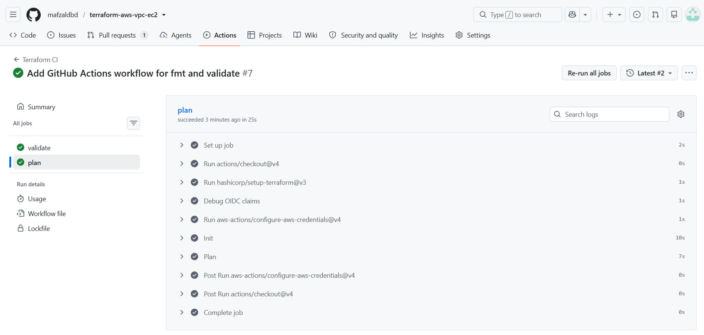

## Stage 1: ECR and RDS

Added two modules for the application tier:

- `modules/ecr`: container registry with image scanning on push and a lifecycle policy that keeps the last 10 images.
- `modules/rds`: PostgreSQL in the private subnets, not publicly accessible, reachable only from the web security group, with the master password generated and stored by AWS Secrets Manager (no password in code or variables).

| RDS instance | ECR repository |
|---|---|
| 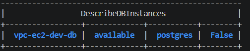 | 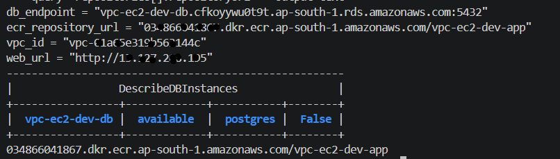 |

## Screenshots

### Deployment

| `terraform apply` complete | Web page served by Nginx |
|---|---|
| 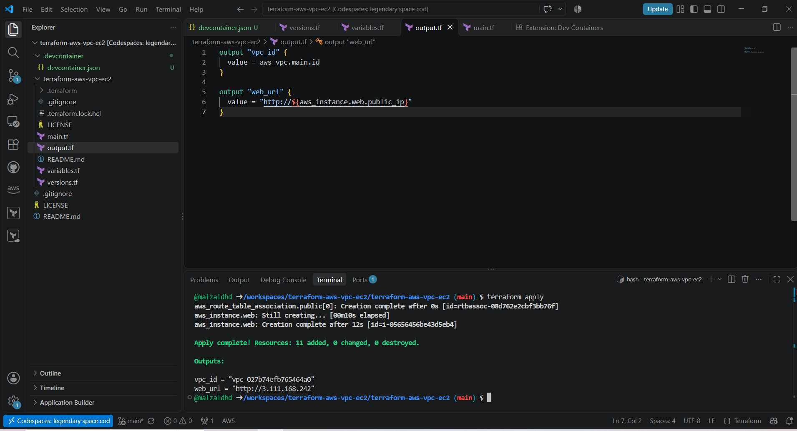 | 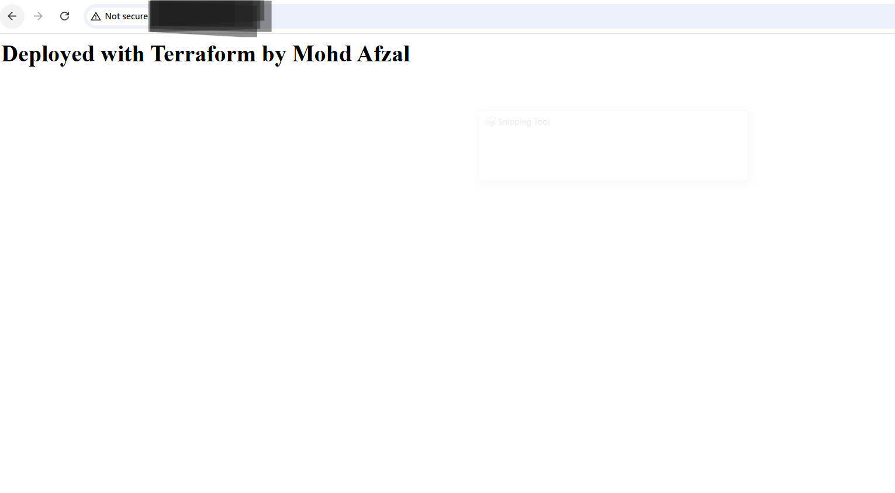 |

### Modular version (dev environment)

| Apply complete | Web page |
|---|---|
| 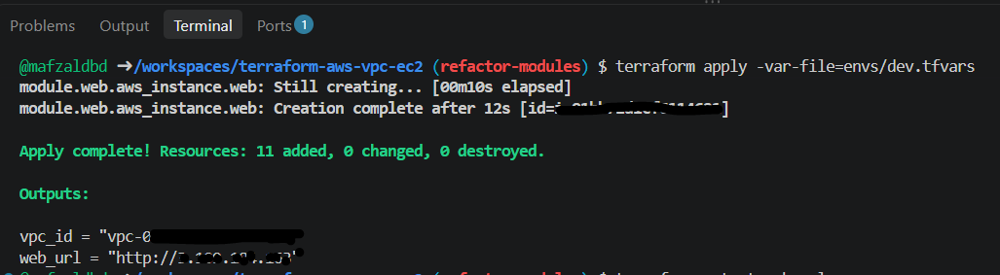 | 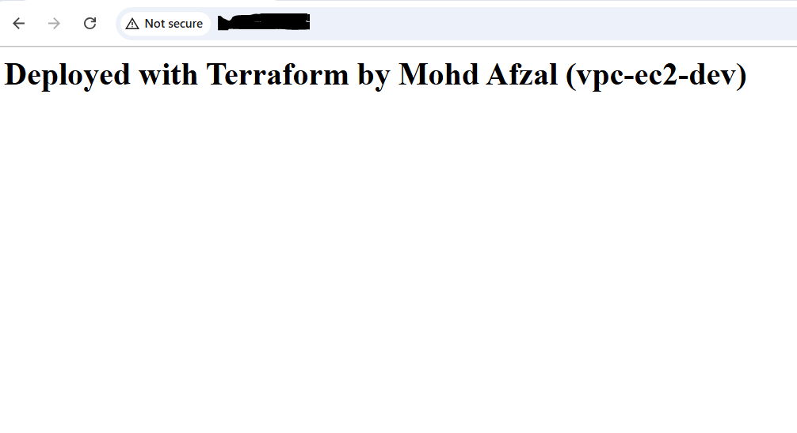 |

### AWS console (ap-south-1)

| EC2 instance | VPC |
|---|---|
| 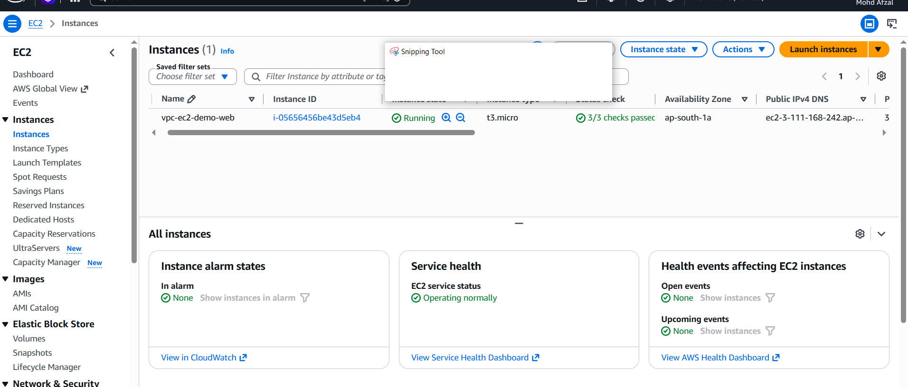 | 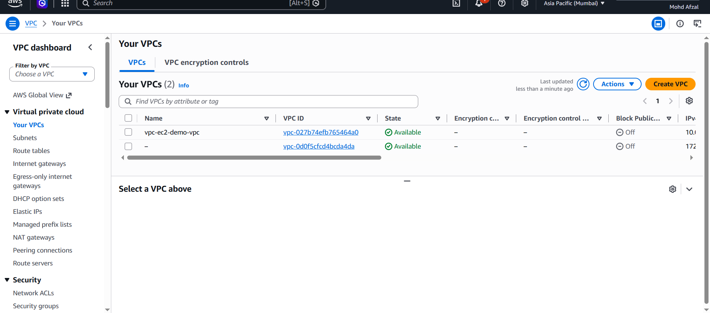 |

| Subnets | Terraform plan (no changes) |
|---|---|
| 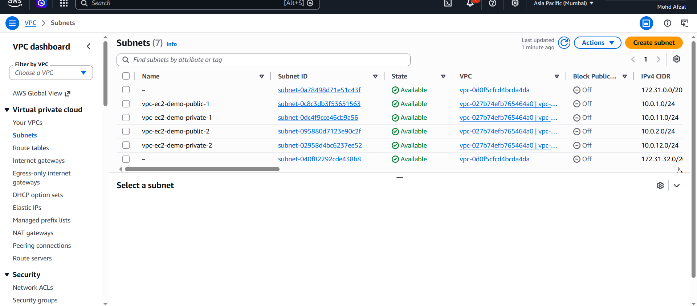 | 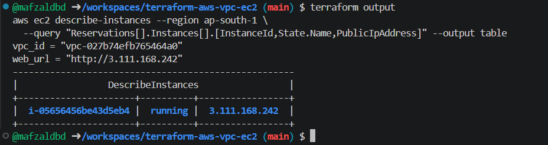 |

## Cost

The EC2 t3.micro instance and the RDS db.t3.micro instance are the billable resources, and both may fall under the AWS Free Tier depending on your account's age. RDS keeps charging while it exists, so run `terraform destroy` after testing.

## Next steps

- Build the Incident Tracker image in GitHub Actions and push it to ECR
- Run the container on EC2 connected to RDS
- Add Prometheus and Grafana monitoring
- Add an approval-gated `terraform apply` job