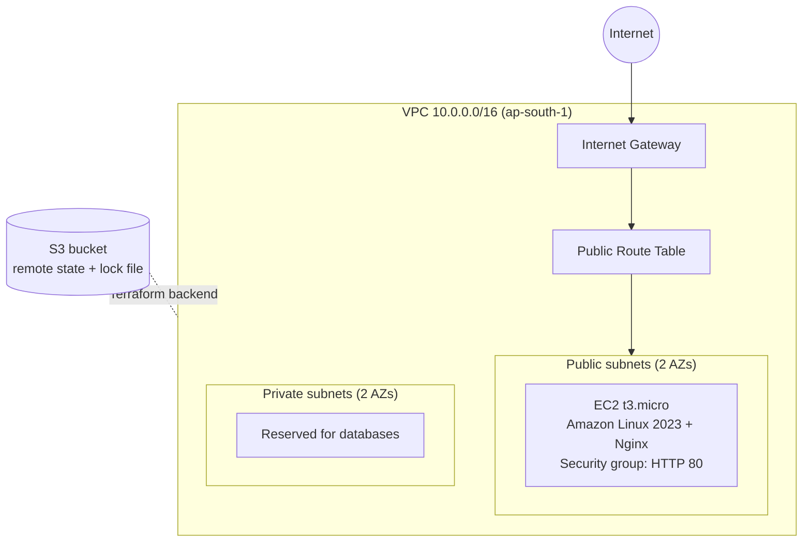

# Terraform AWS VPC + EC2

Provisions a VPC with public and private subnets and a web server on AWS using Terraform, with remote state stored in S3.

## Architecture



## What it creates

## Project structure

```
.
├── main.tf              # Calls the vpc and ec2 modules
├── variables.tf
├── outputs.tf
├── versions.tf          # Provider and S3 backend (native state locking)
├── modules/
│   ├── vpc/             # VPC, subnets, internet gateway, route tables
│   └── ec2/             # Security group and Nginx web server
├── envs/
│   ├── dev.tfvars
│   └── prod.tfvars
└── .github/workflows/terraform.yml
```

## Environments

Each environment has its own variable file and its own state key in S3.

```bash
terraform init -reconfigure -backend-config="key=vpc-ec2/dev/terraform.tfstate"
terraform plan -var-file=envs/dev.tfvars
terraform apply -var-file=envs/dev.tfvars
```

For prod, use `key=vpc-ec2/prod/terraform.tfstate` and `envs/prod.tfvars`.

## CI/CD

A GitHub Actions workflow runs on every pull request to `main`:

1. `terraform fmt -check` and `terraform validate`
2. `terraform plan` against the dev environment

AWS access uses GitHub OIDC with a short-lived, read-only IAM role, so no AWS keys are stored in GitHub.


The private subnets are empty for now and are meant for RDS in a later project. No NAT gateway is included, to avoid hourly cost.

## Prerequisites

- Terraform 1.10 or newer
- AWS CLI configured with credentials that can create VPC and EC2 resources
- An S3 bucket for state. Change the `bucket` value in `versions.tf` to your own bucket name.

## Usage

```bash
terraform init
terraform fmt
terraform validate
terraform plan
terraform apply
```

Open the `web_url` output in a browser to see the Nginx page. Remove everything when finished:

```bash
terraform destroy
```

## Screenshots

### Deployment

| `terraform apply` complete | Web page served by Nginx |
|---|---|
|  |  |

### AWS console (ap-south-1)

| EC2 instance | VPC |
|---|---|
|  |  |

| Subnets | Terraform plan (no changes) |
|---|---|
|  |  |

## Cost

The EC2 t3.micro instance is the only billable compute resource, and it may fall under the AWS Free Tier depending on your account's age. Run `terraform destroy` after testing.