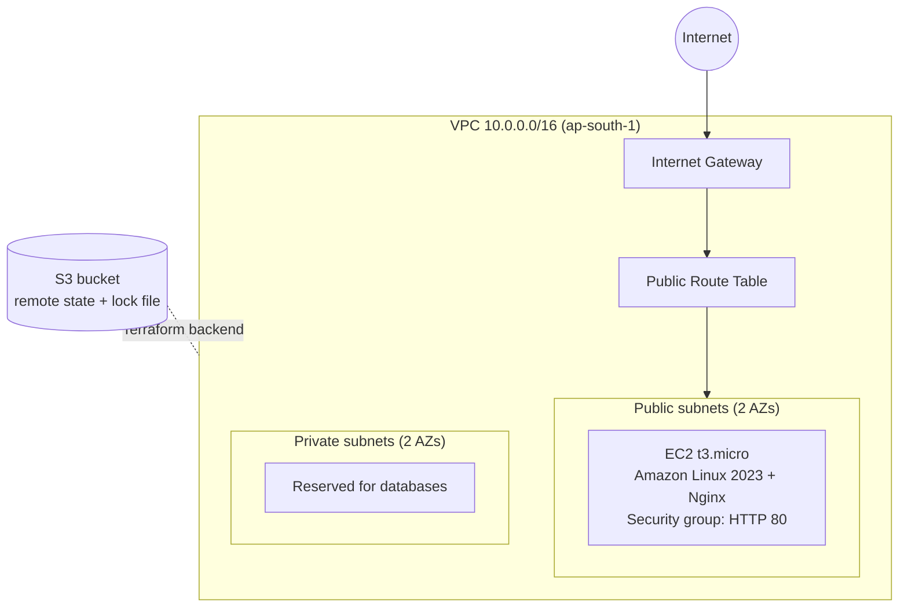

# Terraform AWS VPC + EC2

Provisions a VPC with public and private subnets and a web server on AWS using Terraform, with remote state stored in S3.

## Architecture



## What it creates

- 1 VPC with DNS hostnames enabled
- 2 public and 2 private subnets across two availability zones
- Internet gateway, public route table, and associations
- Security group allowing inbound HTTP (port 80) only
- 1 EC2 instance (latest Amazon Linux 2023 AMI via SSM parameter) running Nginx through user data
- Remote state in S3 with versioning, encryption, and native state locking (`use_lockfile`)

The private subnets are empty for now and are meant for RDS in a later project. No NAT gateway is included, to avoid hourly cost.

## Prerequisites

- Terraform 1.10 or newer
- AWS CLI configured with credentials that can create VPC and EC2 resources
- An S3 bucket for state. Change the `bucket` value in `versions.tf` to your own bucket name.

## Usage

```bash
terraform init
terraform fmt
terraform validate
terraform plan
terraform apply
```

Open the `web_url` output in a browser to see the Nginx page. Remove everything when finished:

```bash
terraform destroy
```

## Screenshots

### Deployment

| `terraform apply` complete | Web page served by Nginx |
|---|---|
|  |  |

### AWS console (ap-south-1)

| EC2 instance | VPC |
|---|---|
|  |  |

| Subnets | Terraform plan (no changes) |
|---|---|
|  |  |

## Cost

The EC2 t3.micro instance is the only billable compute resource, and it may fall under the AWS Free Tier depending on your account's age. Run `terraform destroy` after testing.

## Next steps

- Refactor into reusable `vpc` and `ec2` modules
- Add dev and prod variable files
- Run `terraform fmt`, `validate`, and `plan` in GitHub Actions on every pull request