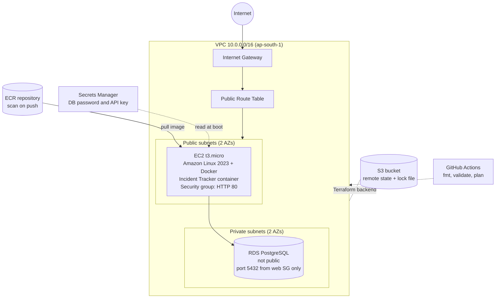
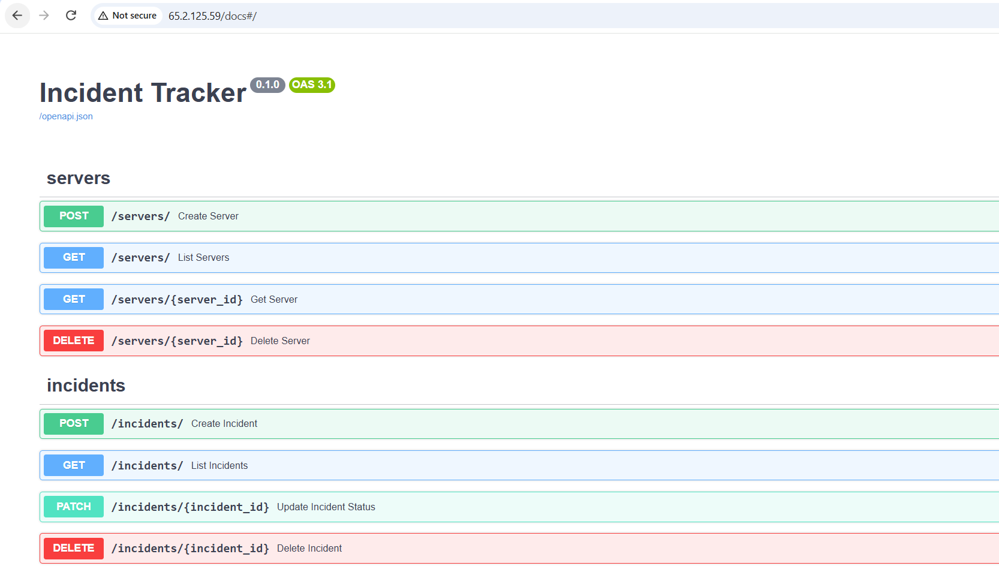
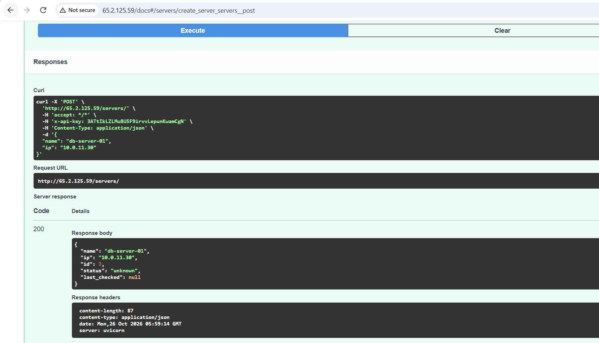
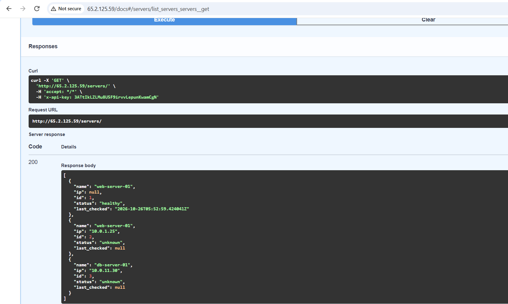
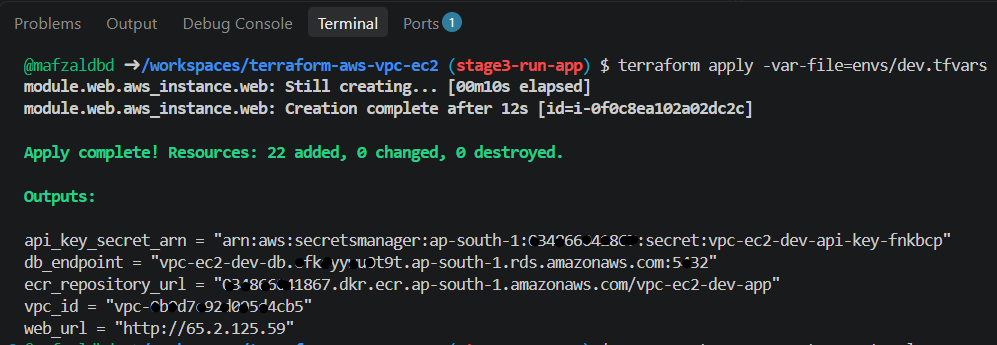
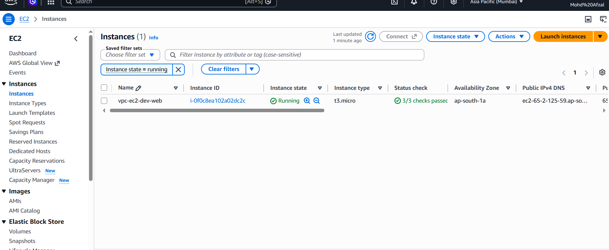
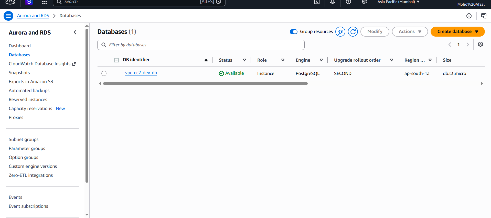
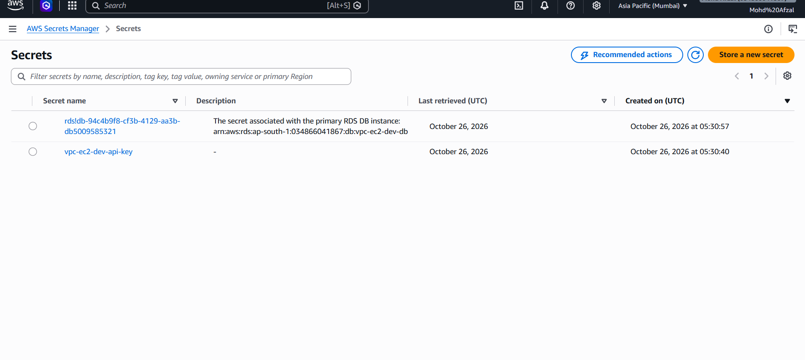

# Terraform AWS VPC + EC2

Provisions a VPC with public and private subnets, a container registry, a private PostgreSQL database, and a web server that runs the [Incident Tracker](https://github.com/mafzaldbd/incident-tracker) container on AWS, using reusable Terraform modules. Remote state is stored in S3, and a GitHub Actions pipeline checks every pull request.

## Architecture



## What it creates

- A VPC with DNS hostnames enabled
- 2 public and 2 private subnets across two availability zones
- An internet gateway, a public route table, and route table associations
- A security group allowing inbound HTTP (port 80) only
- An ECR repository with image scanning on push and a lifecycle policy that keeps the last 10 images
- A private PostgreSQL RDS instance in the private subnets, reachable only from the web security group, with the master password generated and stored by AWS Secrets Manager
- An API key generated by Terraform and stored in Secrets Manager
- An EC2 instance (latest Amazon Linux 2023 AMI via an SSM parameter) with an IAM instance profile that runs the Incident Tracker container pulled from ECR
- Remote state in S3 with versioning, encryption, and native state locking (`use_lockfile`)

No NAT gateway is included, to avoid hourly cost.

## Project structure

```
.
├── main.tf              # Calls the vpc, ecr, ec2, and rds modules
├── variables.tf
├── outputs.tf
├── versions.tf          # Provider and S3 backend (native state locking)
├── modules/
│   ├── vpc/             # VPC, subnets, internet gateway, route tables
│   ├── ecr/             # Container registry with scan on push
│   ├── ec2/             # IAM role, secrets, security group, web server
│   └── rds/             # PostgreSQL in the private subnets
├── envs/
│   ├── dev.tfvars
│   └── prod.tfvars
├── docs/                # Screenshots
└── .github/workflows/terraform.yml
```

## Prerequisites

- Terraform 1.10 or newer
- AWS CLI configured with credentials that can create VPC, EC2, ECR, RDS, IAM, and Secrets Manager resources
- An S3 bucket for state. Change the `bucket` value in `versions.tf` to your own bucket name.
- An application image in the ECR repository (built and pushed by the Incident Tracker pipeline) before the instance boots

## Usage

```bash
terraform init -reconfigure -backend-config="key=vpc-ec2/dev/terraform.tfstate"
terraform fmt -recursive
terraform validate
terraform plan -var-file=envs/dev.tfvars
terraform apply -var-file=envs/dev.tfvars
```

If the ECR repository was destroyed earlier, create it first and push an image before the full apply:

```bash
terraform apply -var-file=envs/dev.tfvars -target=module.ecr
```

RDS takes 5 to 10 minutes to create, and the instance needs a few more minutes to run its start-up script. Open the `web_url` output in a browser (`/docs` shows the API). Remove everything when finished:

```bash
terraform destroy -var-file=envs/dev.tfvars
```

## Environments

Each environment has its own variable file and its own state key in S3. For prod, use `key=vpc-ec2/prod/terraform.tfstate` and `envs/prod.tfvars`:

```bash
terraform init -reconfigure -backend-config="key=vpc-ec2/prod/terraform.tfstate"
terraform plan -var-file=envs/prod.tfvars
```

Run `terraform init -reconfigure` again whenever you switch environments.

## CI/CD

A GitHub Actions workflow runs on every pull request to `main`:

1. `terraform fmt -check` and `terraform validate`
2. `terraform plan` against the dev environment

AWS access uses GitHub OIDC with a short-lived, read-only IAM role, so no AWS keys are stored in GitHub.


## Stage 1: ECR and RDS

Added two modules for the application tier:

- `modules/ecr`: container registry with image scanning on push and a lifecycle policy that keeps the last 10 images.
- `modules/rds`: PostgreSQL in the private subnets, not publicly accessible, reachable only from the web security group, with the master password generated and stored by AWS Secrets Manager (no password in code or variables).

| RDS instance | ECR repository |
|---|---|
|  |  |

## Stage 3: Run the application on AWS

The EC2 instance runs the [Incident Tracker](https://github.com/mafzaldbd/incident-tracker) container, pulled from ECR and connected to the private RDS database.

- **Instance profile:** read-only ECR access, SSM Session Manager (no SSH keys), and `GetSecretValue` limited to the two secrets the app needs.
- **Start-up script:** installs Docker, logs in to ECR, reads the database credentials from Secrets Manager, builds `DATABASE_URL`, creates the tables, and runs the container on port 80.
- **Secrets:** the RDS master password is generated and stored by AWS. The API key is generated by Terraform and stored in Secrets Manager. Neither is written in code or variables. The API key does exist in the Terraform state, which is encrypted in the S3 backend.

| App served from AWS | Create server | List servers |
|---|---|---|
|  |  |  |

| Terraform apply | EC2 | RDS (not public) | Secrets Manager |
|---|---|---|---|
|  |  |  |  |

## Earlier screenshots

### First version (single module-less setup)

| `terraform apply` complete | Web page served by Nginx |
|---|---|
|  |  |

### Modular version (dev environment)

| Apply complete | Web page |
|---|---|
|  |  |

### AWS console (ap-south-1)

| EC2 instance | VPC |
|---|---|
|  |  |

| Subnets | Terraform plan (no changes) |
|---|---|
|  |  |

## Cost

The EC2 t3.micro instance and the RDS db.t3.micro instance are the billable resources, and both may fall under the AWS Free Tier depending on your account's age. RDS keeps charging while it exists, so run `terraform destroy` after testing.

## Next steps

- Add Prometheus and Grafana monitoring
- Add an approval-gated `terraform apply` job
- Add HTTPS with a load balancer, and multi-AZ RDS with backups for a production setup